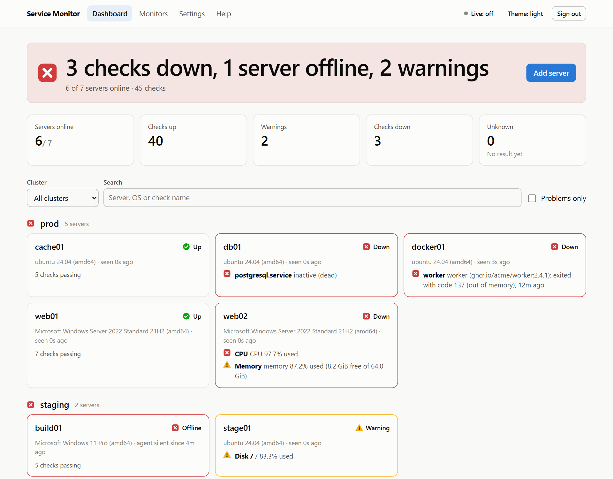
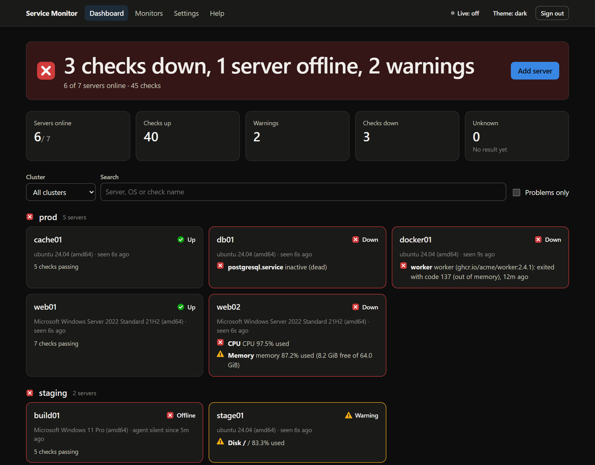
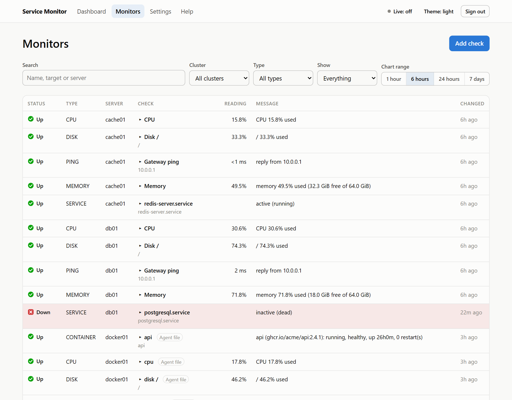
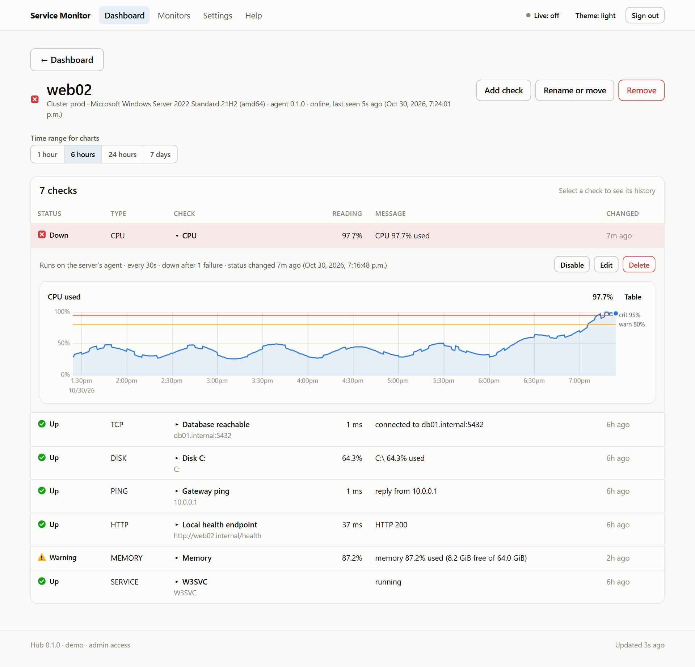
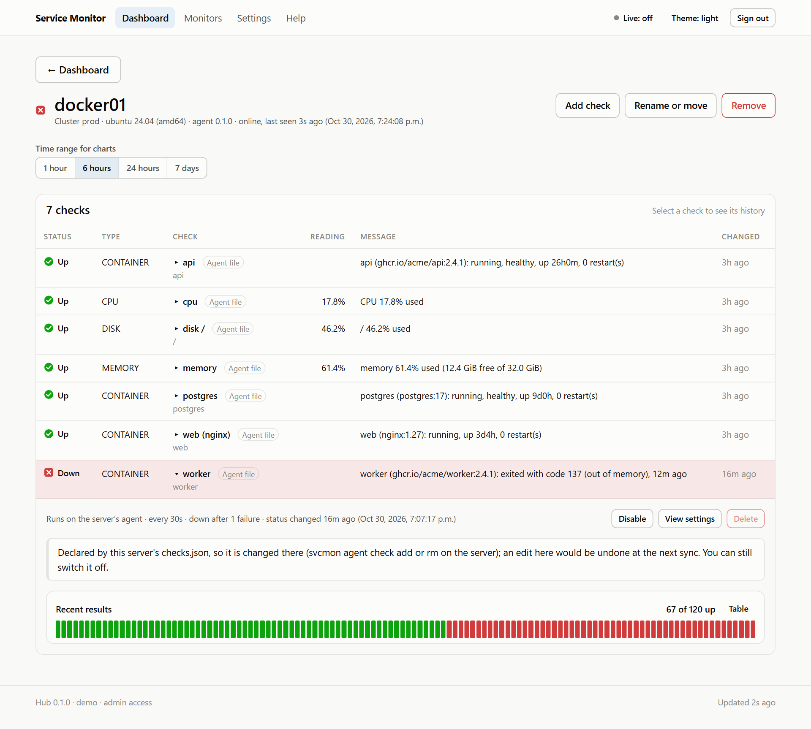
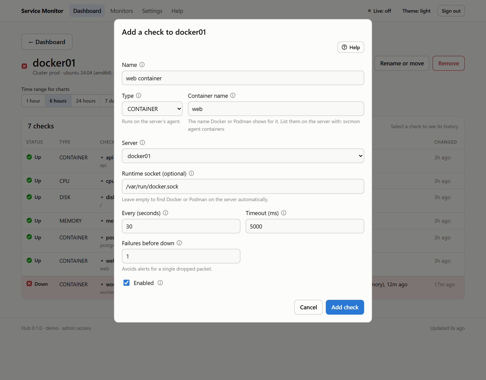
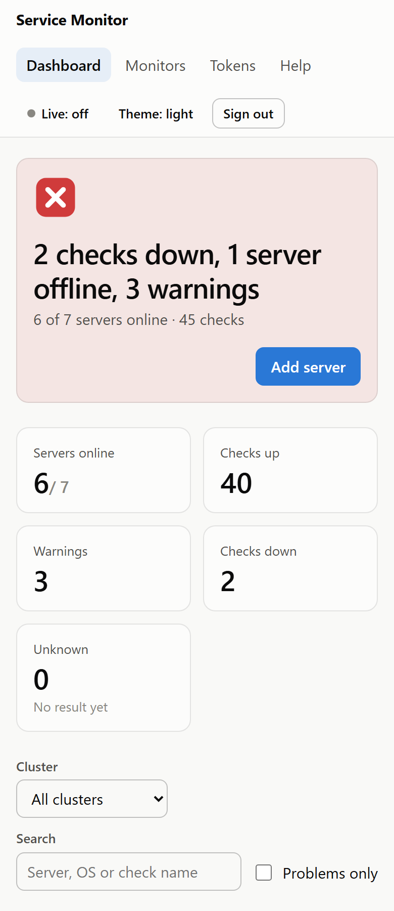

# Service Monitor: what it is for and what it is built with

A plain-language guide for someone who knows Java well and is less sure about the rest of the stack. Facts were checked against the repositories on 2026-10-25 (hub `main` at `1630d17`, dashboard `main` at `1ae864d`). For the reasoning behind the design see `service-monitor-design.md`; for how to run it see `README.md`.

## 1. What it is for

Service Monitor watches your servers and websites and tells you when something is wrong. You list what matters (a website, a Windows service, a Docker container, how full a disk is), it checks on a schedule, and when a check changes state it sends a message to Slack, Discord, email or a webhook. It is free and open source (Apache-2.0) and runs on Windows, Linux and macOS.

A way to picture it: the **hub** is a control room with a logbook and an alarm bell. On each monitored server a small **agent** acts like a caretaker who never answers the phone. The caretaker only ever phones the control room: "what should I check?" and "here is what I found". Because the servers only call out, they open no ports for the monitor, which is the main safety idea of the whole design. The **dashboard** and the **command line** are two ways for you to read the logbook and change the list of things to watch.

What it can check:

| Check | Where it runs | In plain words |
|---|---|---|
| HTTP, TCP, ping | The hub, or an agent | Does this address answer? How fast? |
| Service | An agent | Is this Windows service, systemd unit or macOS job running? |
| Container | An agent | Is this Docker or Podman container running and healthy? |
| CPU, memory, disk | An agent | How full is it, against a warning and a critical level? |

## 2. The big picture

```sketch
Monitored servers (they only call OUT)
  web01: agent   db01: agent   build01: agent
         \            |            /
          \           |           /     HTTPS or plain HTTP inside the network
           +----------+----------+
                      |
                      v
   Load balancer (TLS)  --->  HUB  (Java, Spring Boot)
                               |  scheduler, REST API, alerts, SQLite file
              +----------------+----------------+
              |                                 |
     Dashboard (Svelte)   CLI (svcmon)     Alert channels
     served by the hub    same Go program  Slack, Discord, email, webhook

   Sign-in (optional): Keycloak or another OpenID Connect provider, checked by the hub
```

Three programs live in two repositories:

- **The hub** (`hub/` in the main repository) keeps the list of checks, runs the network checks itself, stores results, works out each server's overall status and sends alerts. It is a Spring Boot application.
- **The agent and the CLI** (`agent/`) are one Go program called `svcmon`. Run as `svcmon agent run` it is the agent on a monitored server; run as `svcmon status` or `svcmon check add` it is the command-line client for the hub.
- **The dashboard** (the separate repository `service-monitor-ui`) is a web page built with Svelte. The hub can serve its files, or any web server can.

### What it looks like

These pictures come from a throwaway demo hub filled with made-up servers (the dashboard repository's `scripts/seed-demo.mjs` plus a small container seeder in `docs/tools/screenshots/`), so nothing in them is a real system. Click a picture to open it full size.












## 3. Why three languages

| Piece | Language and size | Why this choice | Closest Java idea |
|---|---|---|---|
| Hub | Java 21, Spring Boot 4.1.2, about a 37 MB jar | Your language; a long-running server that benefits from virtual threads and a mature ecosystem | The familiar part |
| Agent and CLI | Go 1.27.3, about a 12 MB single file | Must run on every monitored server, so it should need nothing installed there: no JVM, no runtime. Go builds one static program per operating system from one machine | A fat jar that does not need a JVM |
| Dashboard | Svelte 5 with Vite 6; about 213 kB of JavaScript (80 kB compressed) | Small, fast pages. Node is needed only to build; in production it is just static files | A front end that compiles down to plain files |
| Data | SQLite (one file) | No database server to install, patch or back up beyond one file | An embedded H2 or Derby, but far more widely used |

## 4. The technologies, explained

### 4.1 The hub (the Java side)

| Name | What it is | How it is used here |
|---|---|---|
| Spring Boot 4.1.2 | The application framework, fixed by the parent POM | REST controllers under `/api/v1`, configuration through `application.yml` or `--svcmon.*` flags, the embedded Tomcat |
| Virtual threads (Java 21, JEP 444) | Very cheap threads managed by the JVM; blocking in one costs almost nothing | `spring.threads.virtual.enabled` is on. One ordinary thread keeps time in `CheckScheduler`; every check run executes on its own virtual thread, so hundreds of slow checks do not need a big pool |
| JdbcClient | Spring's plain-SQL helper (no JPA, no Hibernate) | The `store/` package writes SQL by hand and maps rows into Java records |
| SQLite and `sqlite-jdbc` 3.53.4.0 | A database that is just a file | Lives in `svcmon.data-dir`. Opened in WAL mode (readers do not block the writer), with a 10 second busy timeout and foreign keys on. The jar carries the native libraries for every platform |
| Flyway | Applies numbered SQL scripts to the database on start | `src/main/resources/db/migration/V1` to `V4`. An applied migration is never edited; a change is a new file |
| Spring WebSocket | A long-lived two-way connection to the browser | `/api/v1/live` pushes the status to a dashboard when it changes |
| Angus Mail 2.0.5 | The implementation of Jakarta Mail | Sends alert emails over SMTP |
| Nimbus JOSE+JWT 10.9.1 | A library for signed tokens | Checks the signed sign-in tokens from your identity provider (section 4.5) |
| Maven | Your build tool | `mvn -B -ntp test` runs the tests, which start the real hub on random ports with temporary data folders |

All of these were checked in the build files and the local Maven cache; their licences are Apache-2.0 for Flyway, `sqlite-jdbc` and Nimbus, and EPL-2.0 or GPL-2.0 with the Classpath Exception for Angus Mail.

### 4.2 The agent and the CLI (the Go side)

Go is small enough to learn the shape of from a table. Left is what you will see in the code, right is the Java idea it maps to.

| In Go | Closest Java idea |
|---|---|
| `go.mod` | `pom.xml`: the module name and its dependencies |
| `go build`, `go test`, `go vet` | `mvn package`, `mvn test`, a static analysis step |
| A package in `internal/...` | A package that other modules cannot import |
| A goroutine (`go f()`) | A virtual thread: start thousands cheaply |
| `context.Context` passed to every call | A cancellation token and deadline handed down through each method |
| `defer x.Close()` | `try` / `finally` |
| Errors are return values (`val, err := f()`) | Instead of checked exceptions; you test `err != nil` |
| An interface is satisfied by having the methods | No `implements`; any type with the methods fits |
| Struct tags like `` `json:"checkId"` `` | `@JsonProperty("checkId")` |
| `//go:build windows` or a file named `x_windows.go` | A source set that only compiles for one operating system |
| `GOOS=linux go build` | Cross-compiling: one machine builds every platform |

Libraries the agent uses (all open source):

| Library | Licence | What for |
|---|---|---|
| `gopsutil` v4.26.9 | BSD | CPU, memory and disk readings that work on Windows, Linux and macOS alike |
| `pro-bing` v0.9.1 | MIT | Sending a ping (ICMP) |
| `golang.org/x/sys` v0.49.0 | BSD-style | Talking to the Windows Service Control Manager so the agent can run as a Windows service |
| `go-winio` v0.6.4 | MIT | Connecting to a Windows named pipe, which is how Docker Desktop is reached. Compiled only on Windows |

Everything else (HTTP, JSON, TCP, files, hashing) is Go's standard library. The one program has two jobs: the agent (`svcmon agent run`) and the CLI (`svcmon status`, `svcmon check add`, and so on).

### 4.3 The dashboard (the JavaScript side)

| Name | What it is | How it is used here |
|---|---|---|
| Node.js (here 20.11.1) | A JavaScript runtime | Runs the build tools on your machine. It is not part of the product when it runs |
| npm and `package.json` | Package manager and its manifest | Like Maven and the POM; `node_modules` is the local copy of the libraries |
| Vite 6.4.5 | A development server and bundler | `npm run build` produces the `dist/` folder of plain files. Vite is pinned to 6 because the newer one needs a newer Node |
| Svelte 5.57.2 | A UI framework that compiles components to plain JavaScript | Each `.svelte` file is one piece of the page (see "A `.svelte` file, up close" below). State is written with "runes" such as `$state` and `$derived`, and the compiler wires the updates, so there is no virtual DOM at run time |
| uPlot 1.6.32 | A very small, very fast chart library | The history charts on a check's page |
| Vitest 3.2.7 | A test runner | The JUnit of this side, run with `npm test` |

The output is just files. They can be copied into the hub jar, which then serves them from inside itself; the hub can also serve them from the folder set in `svcmon.ui-dir`, or the files can go on any web server if the hub allows that address with `svcmon.cors-allowed-origins`.

So at run time the hub is the one server a person talks to: the page it serves calls the hub's REST API (`/api/v1`) for data and opens the live WebSocket for updates. Svelte, Vite and uPlot exist only inside the files the build produced; nothing from Node runs next to the hub.

### A `.svelte` file, up close

A `.svelte` file is one screen component: its logic, its HTML and (optionally) its styles in a single file, the way a Thymeleaf or JSF template and its backing bean would be fused together. This is a shortened and simplified piece of `src/components/CheckForm.svelte`, the Add check form:

```svelte
<script>
  import { AGENT_ONLY_TYPES, CHECK_TYPES } from '../lib/format.js';

  // What the parent hands in, like constructor arguments
  let { servers = [], initial = null, busy = false, onsubmit, oncancel } = $props();

  let type = $state(initial?.type ?? 'HTTP');                    // a field the screen follows
  const agentOnly = $derived(AGENT_ONLY_TYPES.includes(type));   // recomputed when `type` changes
</script>

<select id="cf-type" value={type} onchange={changeType}>
  {#each CHECK_TYPES as t}<option value={t}>{t}</option>{/each}
</select>
{#if agentOnly}<span class="hint">Runs on the server's agent.</span>{/if}
```

| Part of the file | What it is | Closest Java idea |
|---|---|---|
| `<script>` | The component's logic, in ordinary JavaScript | The backing bean or controller class |
| `$props()` | The values and callbacks the parent passes in; `onsubmit` and `oncancel` are callbacks the parent supplies | Constructor parameters plus listener interfaces |
| `$state(...)` | A variable that, when it changes, updates exactly the parts of the screen that use it | A field with an observer attached |
| `$derived(...)` | A value worked out from other values and kept up to date | A getter that is recomputed on demand |
| The HTML below the script | The layout. `{value}` inserts a value, `{#if}` shows something conditionally, `{#each}` repeats it | `th:text`, `th:if` and `th:each` in Thymeleaf, or `c:if` and `c:forEach` in JSTL |
| `<style>` (not in this file) | CSS that applies only to this component | A scoped stylesheet. Here the shared styles live in `src/app.css` instead |

Browsers never see a `.svelte` file. When Vite builds the dashboard, the Svelte compiler (connected to Vite by `@sveltejs/vite-plugin-svelte`) turns each one into plain JavaScript that updates the page directly, and `dist/` holds only ordinary files. The other file types in the dashboard repository are: `.js` (the logic that is not a screen: the hub client, formatting, sign-in, and the tests in `test/`), `.mjs` (Node scripts such as `scripts/seed-demo.mjs`), `.css` and `index.html` (the page the whole app is mounted into).

### 4.4 Running it as a service

A "service" is a program the operating system starts at boot and restarts if it dies.

| Name | What it is | How it is used here |
|---|---|---|
| Windows Service Control Manager | Windows' own service manager | The agent registers itself with it (`svcmon agent install`) |
| WinSW 2.12.0 (MIT) | A small wrapper that turns any program into a Windows service | The hub is a plain jar, so WinSW starts `java -jar` for it. The installer checks the WinSW file against a pinned SHA-256 and refuses a different copy |
| systemd | The Linux service manager | A unit file starts the agent or the hub |
| launchd | The macOS service manager | The agent has a launchd installer. It compiles but has never been run on a real Mac |
| `--dry-run` | A flag on the install scripts | Prints exactly what would change and changes nothing |

### 4.5 Security and sign-in words

| Word | What it means | How it is used here |
|---|---|---|
| Bearer token | A secret string sent in the `Authorization` header | Every call to the hub carries one. The hub stores only a SHA-256 fingerprint of each token, never the token |
| Scopes | What a token may do | `ADMIN`, `READ`, `ENROLL`, `JOIN` and `AGENT` |
| Enrollment token and join key | How a server proves it may register | An enrollment token works once; a join key registers many servers until it is revoked. Each server then receives its own `AGENT` token |
| JWT and OpenID Connect | A signed token that proves who someone is, issued by a sign-in provider | Optional. The hub checks the signature, issuer, audience and expiry itself |
| Identity provider (Keycloak is the one tried) | The service that signs people in and issues the tokens. Use whichever your organisation already runs | The hub is told four things: `svcmon.jwt.issuer` (the provider's address), `audience`, `admin-role` and `roles-claim` (where the roles sit inside the token), and `jwks-uri` only if the provider keeps its signing keys somewhere unusual. Nothing else is Keycloak-specific; Keycloak is only the default for `roles-claim` and the one provider that has been tried. Another should work if its access tokens are JWTs signed with an asymmetric key and carry a role you can name. Some providers issue opaque access tokens by default, which the hub cannot check. The hub never needs to know anyone's password |
| PBKDF2 | A deliberately slow way to store a password | The passwords of the hub's users |
| TLS termination | The encryption endpoint | Done by a load balancer in front of the hub; inside the network the hub speaks plain HTTP. `X-Forwarded-For` and similar headers carry the real client address through the balancer |
| CORS | The rule a browser applies before one site may call another | Only matters when the dashboard is hosted on a different address from the hub |

### 4.6 Container checks

| Word | What it means | How it is used here |
|---|---|---|
| Docker Engine API | The interface Docker (and Podman, which copies it) offers on a local connection | The agent asks it about one container by name |
| Unix socket and named pipe | A local doorway between programs on one machine. Linux and macOS use a file called a socket; Windows uses a named pipe | `/var/run/docker.sock` on Linux; `\\.\pipe\docker_engine` and `dockerDesktopLinuxEngine` for Docker Desktop on Windows |
| Read-only on purpose | The doorway is as powerful as root | The agent code has only a GET path to it, so it can read state and nothing else |

### 4.7 Delivery and workflow

| Name | What it is | How it is used here |
|---|---|---|
| GitHub and GitHub Actions | The code host and its automatic build service | CI runs the hub tests on Ubuntu and Windows, the agent tests on Ubuntu, Windows and macOS, a formatting check, a cross-compile of every platform and an installer dry run |
| Protected `main` | A branch nobody pushes to directly | Changes go through a pull request, and the check named "CI passed" must be green |
| Squash merge | Combines a pull request into one commit | How every change was merged |
| Apache-2.0 | The licence of this project | Free to use, change and share |

## 5. How the pieces work together

### A new server joins

1. An admin creates an enrollment token (or one reusable join key for many servers).
2. On the server, `svcmon agent install --hub http://hub:8080 --token ...` registers it and installs the service.
3. The hub answers with the server's own agent token, saved in `agent.json` next to the program.
4. Nothing is monitored yet. Someone lists the checks for that server: on the server itself (`svcmon agent check add`), or an admin in the dashboard or with `svcmon check add`.

### One check from creation to alert (a container example)

1. The admin adds a container check for `web` on server `web01`. The hub stores it.
2. The agent asks the hub for its list every 60 seconds, so within about a minute it learns about the new check.
3. It runs the check on its own schedule (30 seconds by default for agent checks): it asks Docker, and works out "running and healthy" (UP), "health check still starting" (WARN) or "stopped or missing" (DOWN).
4. Results go back to the hub on its heartbeat (30 seconds by default), and a failure is sent within about a second.
5. The hub keeps the result for 30 days. A check turns DOWN only after the configured number of failures in a row, so one dropped packet does not page anyone.
6. When the status changes, the hub sends a message to every alert channel that wants that status. If a server's agent goes silent for 90 seconds, the hub shows it offline and alerts about that too.

### Checks declared by the agent

1. Instead of clicking in the dashboard, you put a `checks.json` beside `agent.json` on the server.
2. The agent sends it to the hub at start-up and whenever the file changes (looked at once a minute).
3. The hub creates, updates or switches off checks to match, and the agent runs them from its normal list.
4. If the file and the hub disagree about a check, the file wins. This is on by default; a hub that sets `svcmon.agent-declared-checks: false` refuses it.
5. On the server, `svcmon agent check add|rm|list` edits that file for you and sends it at once, so no login to the hub is needed.
6. The agent also keeps the check list the hub last gave it in `assigned.json`, so an agent restarted while the hub is down keeps checking and buffers the results.

### The hub restarts

The agent keeps up to 5,000 results in memory and sends them when the hub is back, so a restart leaves no gap and raises no false alert.

## 6. Where things live

| Path | What is there |
|---|---|
| `hub/src/main/java/io/primelogiclab/svcmon/hub/` | `api` (REST controllers), `core` (scheduler, services), `checks` (HTTP, TCP and ping runners), `alerts` (senders), `security` (tokens, sign-in), `store` (SQL), `live` (WebSocket), `model`, `config` |
| `hub/src/main/resources/` | `application.yml` and the Flyway migrations |
| `hub/service/` | Install and uninstall scripts for the hub as a service, with their tests |
| `agent/cmd/svcmon/` | The program's entry point |
| `agent/internal/` | `agent` (the run loop), `checks` (every check type), `cli` (the commands), `hubapi` (the hub client), `osservice` (the operating-system service code) |
| `docs/` | The design document and this guide, each as Markdown and HTML |
| `service-monitor-ui/` (separate repository) | The dashboard: `src/`, `test/`, `scripts/seed-demo.mjs` |

## 7. Build, test and run

Run these from the folder shown; on this machine Go and Node need their cache folders set (see `CLAUDE.md`).

| What | Command |
|---|---|
| Hub tests | `cd hub` then `mvn -B -ntp test` |
| Hub jar | `mvn -B -ntp -DskipTests package` gives `hub/target/svcmon-hub-0.1.0-SNAPSHOT.jar` |
| Agent and CLI | `cd agent`, then `go vet ./...` and `go test ./... -count=1` |
| Dashboard | `npm test` and `npm run build` in the dashboard repository |
| Try everything together | Start the hub with `--svcmon.ui-dir=<dashboard>/dist`, then run `scripts/seed-demo.mjs` against a throwaway hub |

## 8. The rules that shape every decision

1. **Agents only connect out.** A monitored server opens no inbound port for the monitor.
2. **Someone lists what is monitored.** An admin in the hub, or the person setting up the server in its `checks.json`. Nothing is discovered and monitored on its own; the helper commands only list what exists.
3. **TLS ends at the load balancer.** The hub speaks plain HTTP inside the network and must work behind `X-Forwarded-*` headers.
4. **Secrets stay hidden.** Tokens (only fingerprints are stored), webhook addresses, header values, signing secrets and the SMTP password never leave the hub unmasked and never appear in logs or errors.
5. **Be strict.** Unknown settings are rejected, so a typo fails loudly. Names and messages from agents are treated as untrusted (Slack markup is escaped, Discord mentions are off, mail headers cannot be injected).
6. **Free everywhere.** Everything is open source, and the hub and agent run on Windows, Linux and macOS.

## 9. Limits and open questions

- **Not built:** the multi-hub "console" role, a dashboard page for alerts, a bundled Java runtime and a release pipeline, a macOS hub installer, per-container CPU and memory, and Telegram or ntfy alert channels.
- **Not tried on real systems:** the macOS agent installer and service checks; container checks on Linux and with Podman; agent-declared checks on an installed service.
- **Dashboard gap:** it does not yet show where a check comes from (hub or agent file) or lock the form for a check the agent declares. The hub already refuses the edit.
- **Resource figures** in the design document (memory, disk) are estimates, not measurements.
- **Not covered here:** how the live deployment on a cloud server is laid out; that lives in a separate infrastructure repository.

## 10. References

**Hub (Java)**

- Spring Boot: https://spring.io/projects/spring-boot and its reference documentation https://docs.spring.io/spring-boot/
- Virtual threads (JEP 444): https://openjdk.org/jeps/444
- SQLite: https://www.sqlite.org/ and the Java driver https://github.com/xerial/sqlite-jdbc
- Flyway: https://flywaydb.org and https://github.com/flyway/flyway
- Nimbus JOSE+JWT: https://connect2id.com/products/nimbus-jose-jwt
- Angus Mail (Jakarta Mail): https://eclipse-ee4j.github.io/angus-mail/
- Maven: https://maven.apache.org/

**Agent and CLI (Go)**

- Go documentation: https://go.dev/doc/ , a tour: https://go.dev/tour/ and the style guide: https://go.dev/doc/effective_go
- gopsutil: https://github.com/shirou/gopsutil
- pro-bing: https://github.com/prometheus-community/pro-bing
- golang.org/x/sys: https://pkg.go.dev/golang.org/x/sys
- go-winio: https://github.com/microsoft/go-winio

**Dashboard (JavaScript)**

- Node.js: https://nodejs.org/
- Svelte: https://svelte.dev, its interactive tutorial https://svelte.dev/tutorial and its reference https://svelte.dev/docs/svelte/overview
- The plugin that connects Svelte to Vite: https://github.com/sveltejs/vite-plugin-svelte
- Vite: https://vite.dev
- uPlot: https://github.com/leeoniya/uPlot
- Vitest: https://vitest.dev

**Running as a service and containers**

- WinSW: https://github.com/winsw/winsw
- systemd: https://systemd.io
- launchd (a community tutorial; Apple's own pages did not answer when checked): https://www.launchd.info/
- Docker Engine API: https://docs.docker.com/reference/api/engine/
- Podman's API: https://docs.podman.io/en/latest/_static/api.html

**Security and web standards**

- OpenID Connect: https://openid.net/connect/
- JSON Web Token, RFC 7519: https://www.rfc-editor.org/rfc/rfc7519
- PBKDF2, RFC 8018: https://www.rfc-editor.org/rfc/rfc8018
- WebSocket, RFC 6455: https://www.rfc-editor.org/rfc/rfc6455
- Keycloak, the identity provider tried with the hub (any OpenID Connect provider can be configured instead): https://www.keycloak.org
- CORS: https://developer.mozilla.org/docs/Web/HTTP/CORS
- `X-Forwarded-For`: https://developer.mozilla.org/docs/Web/HTTP/Headers/X-Forwarded-For
- Apache License 2.0: https://www.apache.org/licenses/LICENSE-2.0
- GitHub Actions: https://docs.github.com/actions

**In this repository**

- `README.md` (stack and quick start), `docs/service-monitor-reference.md` (how to use it), `docs/service-monitor-design.md` (why it is built this way) and `CLAUDE.md` (the working agreement)
